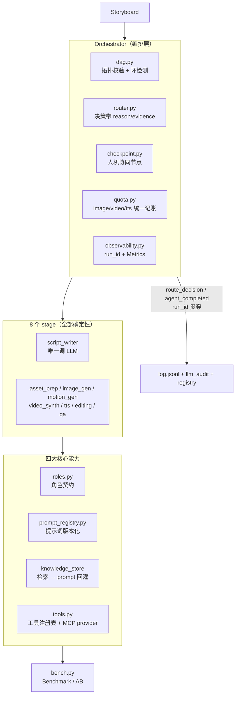

# V5.0 — 「AI Agent 搭建流程图」逐条映射与判定

> 创建于 2026-11-03
> 起因：用户给出「AI Agent 搭建流程图」，要求按图对项目做重构与设计。
> **本文档是那次"设计"的主产出** —— 图的每个步骤在这里都有判定与证据。

---

## 0. 结论先行

> **不做架构重构。** 把图当**检查清单**用：逐条打分，该补的补、不该补的砍。
>
> 判定结果：**8 项该补（已补）、3 项明确不补、1 项部分补**。
> 其中 5 项是修真缺陷（与"框架"无关也该修），3 项是框架补齐。

### 为什么不做架构重构

| # | 证据 | 含义 |
|---|---|---|
| 1 | 全项目只有 **3 次 LLM 调用**（`script_engine.py` 的小说→剧本→角色→分镜） | 主体是确定性管道 |
| 2 | `grep "tools=\[\|function_call\|tool_choice\|json_schema"` → **0 命中** | 没有 function-calling、没有工具选择、没有 LLM 决策循环 |
| 3 | `grep "replan"` → **0 命中** | 没有自主重规划 |
| 4 | Hailuo **3 条/天**、image-01 **按张计费** | agent 化会让成本乘 N |
| 5 | 交付物是**客户的成片** | 可复现 > 自适应 |

图里第 2 步自己写着：「是否合适？否 → 使用规则脚本/SQL → 结束」。
**本项目的答案就是"否"** —— 这不是逃避，而是这张图的设计意图：
它先问你"这活儿适合 agent 吗"，不适合就别硬套。

---

## 1. 逐条映射

### 步骤 1 · 开始 → 步骤 2 · 场景定义与可行性评估

**判定：❌ 主体不适用 agent（保持确定性）；✅ 但要写进代码而不是只写进文档**

这一条是整个判断的**锚点**。本项目 8 个 stage 里**只有 `script_writer` 调 LLM**，
其余全是确定性管道。这件事此前只存在于各人的脑子里 —— 现在它是一条**断言**：

```python
# tests/test_roles_prompts_tools.py
def test_only_one_stage_calls_llm():
    assert llm_roles() == ["script_writer"]
```

任何人往确定性 stage 里塞 LLM 决策，**门禁会红**。

### 步骤 3 · 框架选型与模型选择

**判定：⚠️ 部分补**

| 项 | 判定 | 依据 |
|---|---|---|
| 编排框架 | **不引入 LangGraph** | 现有 DAG 已 8 阶段、拓扑简单；LangGraph 的价值在状态机/循环/人机协同，我们只需要后两个 → 自研约 200 行更轻。代价：1000 行稳定代码换框架约束不划算，且 1400+ 测试要重跑依赖解析 |
| 模型选择 | **不换** | `MiniMax-M3` 保留（think 剥离已让它可用）；更快的 `MiniMax-M3.1-Flash` 可用 env 切换 |
| DAG 依赖声明 | **✅ 补** | `Phase.inputs_from` 此前是**装饰性文档** —— 改它 pipeline 行为不变。现在变成可执行约束（`dag.py`：拓扑排序 + 环检测 + 依赖缺失 + 顺序违规 + agent 存在性） |

### 步骤 4 · 四大核心能力

#### 4.1 角色 + 提示词 —— ✅ 补

**此前**：agent 层**零角色定义**（`grep "persona|职责|禁则"` → 0 命中）；
提示词无版本（`grep "prompt_version"` → 0 命中）。

**现在**：
- `roles.py` — `RoleSpec`（职责 / 输入 / 输出 / **禁则** / **降级策略** / 是否确定性 / 成本影响），
  8 个 agent 各自声明 `role_name`，测试断言全覆盖
- `prompt_registry.py` — `PromptSpec`（id / version / variables / **content_hash**），
  现有 4 个常量注册进去但**不删**（老调用方零影响）；
  `content_hash` 写进审计日志 → 事后能回答"这条成片是哪个提示词版本产的"

#### 4.2 规划能力 —— ✅ 补（接线）

**此前**：`director.validate_director_brief()` 已实现且有单测，**生产零调用**；
`brief_for_shot` 的 docstring 声称"规划 + 自校验"，实现里**从没调过它**（docstring 与实现不符）。

**现在**：
- 自校验结果落进 `Shot.director_warnings`，随 storyboard.json 落盘，人工审稿可见
- `brief_for_shot` 真正校验，`DirectorBrief.issues` 承载结果
- 叙事记忆接线：`continuity_from_prev` / `emotion_arc_point` 进 motion prompt
  （此前**有 schema 无消费** —— 只被 `scripts/explain_story.py` 打印给人看）

**刻意不做**：replan（自主重规划）。当前规划失败 = 硬失败（`LLMError` 直接抛）。
加 replan 会引入"重试烧额度"的路径，而配额只有 3 条/天。

#### 4.3 记忆系统 —— ✅ 补（接线）

**此前**：`knowledge_store` 的 `search` / `related` / `lessons` **生产零调用**
（只有 tests 引用）—— 知识库**只写不读**，8 条真实生产经验从不回灌。

**现在**：读侧接进 `image_gen` / `motion_gen` 的 prompt 构造。
经验放在**风格前缀之后、内容之前**（知识库 `mp_0005` 的原话：
"色锁写在 description 末尾会失效 —— 色彩约束必须放在 prompt 开头"；
但 V3.3 实测 `style_anchor` 必须守第 0 位，两者折中见 `_inject_hint`）。

#### 4.4 工具集成 —— ✅ 补

**此前**：`agents.py` 顶部 11 个直接 import；`mcp_client.py`（266 行）**整个模块零引用**。

**现在**：`tools.py` — `ToolSpec`（name / description / parameters JSON schema / handler /
**cost** / mutating / timeout）+ `ToolRegistry`，现有确定性能力登记成 7 个工具。

**刻意不做 function-calling**：8 个 stage 全确定性，没有 LLM 需要"选择工具"；
引入它会让确定性管道多一层**不可复现**的模型决策。

**MCP 的处置**：`mcp_client` 实现不动，作为 **provider** 收编 ——
不可用时**一个假工具都不注册**（而不是注册一堆调不通的）；
将来真 MCP 后端可用时工具会自动出现在清单里。

### 步骤 5 · 多智能体？→ MAS + 路由 + 执行 + 审计

**判定：❌ 不需要 MAS；✅ 但需要路由层与审计**

不需要 MAS 的理由同上（确定性 DAG 更优）。
但审计发现**唯一的动态决策是硬编码 if**：
conditional phase 分派绑定在 **phase 名字符串**上，
选镜规则写死在函数体里 —— **决策过程不可解释、不可配置、不可测试**。

**现在**：
- `router.py` — `RoutePolicy` ABC + `MotionComplexityPolicy`（原逻辑**逐行等价搬移**）
  + `Router`（决策带 `reason` / `evidence`，落 `log.jsonl` 的 `route_decision` 事件）
- `dag.py` — DAG 校验（见步骤 3）

### 步骤 6 · 人机协同节点

**判定：✅ 补**

**此前**：`grep "input(\|confirm\|--yes\|approve\|interactive"` → **0 命中**。全流程 fire-and-forget。

**现在**：`checkpoint.py` — 跑到检查点**干净停下**（`source="checkpoint"`，`ok=True`，
CLI 退出码 **3** = 暂停待确认），产出人读报告，人确认后 `--resume-from <下一个 phase>` 续跑
（**复用既有 registry.json 续跑机制**，不引入新机制）。

**默认只开 `prep`**（参考图确认）—— 它是整条链路里**最贵**（每角色 7 张图）
也**最容易出错**（"小黄变猫"事故就发生在那）的一步。
`daily_cron.py` **显式 `--checkpoint none`** —— 无人值守生产不能等人确认。

**实测价值**：在 `sample/story_arc_xiaohuang_daily/day1.json` 上跑，
报告自动抓出了「小黄」是中文歧义色词 + 与 appearance 的犬种描述冲突
——**正是那个客户事故的成因**，在烧掉下游链路之前拦住了。

### 步骤 7 · 开发与部署（工作流编排 / LangGraph）

**判定：⚠️ 部分补**

| 项 | 判定 | 依据 |
|---|---|---|
| 工作流编排 | 自研（见步骤 3） | |
| CI | **已有**（`.github/workflows/ci.yml`，py3.11/3.13） | V3.9 补的 |
| pre-commit | 已有 `.githooks/pre-commit`（opt-in） | |
| 容器化 | **不做** | 这不是服务，是本地脚本。Docker/K8s 对本项目零收益 |
| 部署 | 已有 `scripts/deploy_to_mac.sh` | |

### 步骤 8 · 测试与评估（Benchmark / AB Test）

**判定：✅ 补**

**此前**：`grep "ab_test\|golden\|snapshot\|benchmark"` → **0 命中**。
1400+ 个 pytest 用例很扎实，但**没有**"用固定输入跑完整流程并比指标"的能力。
而 **Hailuo 3 条/天意味着真 API 上根本做不了 A/B** —— mock bench 是唯一可行路径。

**现在**：`bench.py` — 3 个内嵌 fixture（单镜 / 双角色双镜 / 三镜三场景）、
`run_all()`（全 mock、零网络、零额度）、`compare_prompt_versions()`（静态比较，
最便宜的 A/B）、`run_ab()`（端到端 A/B）、JSON + Markdown 报告。

### 步骤 9 · 可观测性接入（Trace / 日志 / 监控）

**判定：✅ 补（但不做 OTel）**

**此前**：三套日志**各记各的、互不关联**（`log.jsonl` / `llm_audit.jsonl` / `runs.jsonl`）；
`log.py` 的 docstring 举例 `"agent_completed"`，但全仓**从未 emit 过**；
`PipelineResult.bytes` **从未赋值**（恒 0）。

**现在**：
- `run_id` 贯穿 `log.jsonl` 的**每个**事件 + `registry.json` 的 meta 块（向后兼容）
- 补上 **agent 级**事件 `agent_completed`
- `Metrics` 聚合（per-phase 调用数 / 成功率 / 耗时）+ 成本**估算**（相对单位）
- `PipelineResult.bytes` 按实际文件大小赋值

**不做 OpenTelemetry / LangSmith / Langfuse**：本地单用户脚本，无多租户/分布式，
`run_id` + jsonl 已经够用。加依赖不划算。

### 步骤 10 · 上线生产 → 持续治理与成本优化 → 循环回顾生产环境

**判定：✅ 补**

**此前**（真实缺陷，不是假设）：

| 漏洞 | 后果 |
|---|---|
| 配额记账**只在 `daily_cron.py`** | 绕过 cron 直接跑 pipeline → **计数器与真实消耗完全脱钩** |
| `motion_budget` 只是**单次 run 内**的 top-N 截断 | **不是**每日计数器 |
| **image / tts 完全无限额** | 最常调用的接口零预算约束 |
| cron 与编排器是**两套实现** | 会漂移 |

**现在**：`quota.py` — image / video / tts 三类统一记账、按日 reset、原子写。
记账点在**编排器**（调 backend 之前 consume），额度不足 → 跳过 + 明确告警。
账本损坏 → **硬失败**（成本域按密钥域处理：静默重建 = 把"已用 3 条"当成"已用 0 条"）。
`daily_cron.py` 删掉自带的那份实现 → **单一实现**，且改成**兜底记账者**
（编排器已记则不重复记，否则跑一次算 2 → 额度提前耗尽）。

**循环回顾**：知识库读侧接线（4.3）+ VLM 评审接口（V3.8 已有）+ bench/AB（步骤 8）
→ 「生产 → 记录 → 检索 → 回灌」的闭环首次**真正闭合**。

---

## 2. 架构对比

### 补齐前

```
[Storyboard] → [Orchestrator: 8 phase 顺序循环]
                  ├─ 硬编码 if 分派（绑 phase 名字符串）
                  ├─ 决策不落日志
                  └─ Phase.inputs_from = 装饰性文档
[11 个直接 import 的 engine 调用]
[3 套互不关联的日志]
[配额只在 cron 层记账]
[0 个人机协同节点]
```

### 补齐后



---

## 3. 明确不做的 3 项（以及为什么）

| 不做 | 理由 |
|---|---|
| **LangGraph / 任何新编排框架** | 1000 行稳定代码换框架约束不划算；我们只需要"循环 + 人机协同"两个特性，自研约 200 行更轻；新增依赖会让 1400+ 测试重跑依赖解析，Windows cp932 环境有风险 |
| **8 个 stage 全 agent 化** | 硬约束不支持：Hailuo 3 条/天、image-01 按张计费、交付物要可复现。强行 agent 化 = 成本乘 N + 不可复现 = **架构退化** |
| **OpenTelemetry / LangSmith / Docker / K8s** | 本地单用户脚本，无多租户/分布式、无服务化需求。`run_id` + jsonl 已经够用 |

---

## 4. 本轮顺带修掉的真实缺陷

这一节值得单列 —— 它们**不是框架洁癖**，是"看起来成功实际失败"：

| 缺陷 | 影响 | 引入于 |
|---|---|---|
| **真 LLM 路径从未跑通** | 4 个缺陷叠加（prompt/schema 矛盾 → 模型疯狂推理 → 推理吃光 `max_tokens` → content 空；加上缺 `response_format`、`<think>` 泄漏、60s 超时打掉 95s 的成功请求、渲染层 `{{}}` 转义没还原）。PRD 的 `R1 [UNVERIFIED]` 是准确的 —— 测试全绿但**全走 mock** | 一直存在 |
| **成片从不落到用户请求的 `-o` 路径** | editing 恒写 `run_dir/final.mp4`，从不拷贝；CLI 报 `[OK] out/final.mp4 (0 bytes)` —— **报成功但用户要的路径上什么都没有** | V3.4（`8379da1`） |
| **`PipelineResult.bytes` 从未赋值** | 恒 0 → CLI 永远打印 "(0 bytes)"，看起来像"产出了空文件" | 一直存在 |
| **pipeline CLI 只能打真实 Hailuo** | `--image-backend mock --tts-backend mock` 不影响 motion 阶段 → 任何试跑都烧掉当天 3 条/天额度 | 一直存在 |
| **`--motion-backend mock` 形同虚设** | motion_gen 自己造 task（不走 `_build_task`），漏了 `motion_backend` → 回落到真 Hailuo | 同上 |
| **`--resume-from` 拒绝 `script` / `motion_gen` / `editing`** | choices 写死且含早已改名的 `concat`；checkpoint 的续跑起点会被 argparse 直接拒掉 | 一直存在 |
| **续跑会再次停在已跳过的 phase** | checkpoint 检查对被 resume 跳过的 phase 也触发 → 续跑永远走不下去 | 本轮引入，当场修掉 |
| **生产审计零产出** | `audit_llm` 有完整实现 + 27 个测试，但生产从不传 `project_id` → `if project_id:` 恒假 → **一条审计日志都不产生** | 一直存在 |
| **知识库只写不读** | `search` / `related` / `lessons` 生产零调用 → 8 条真实生产经验从不回灌 | V3.8 |
| **`mcp_client` / `publish_agent` 整个模块零引用** | 分别是 266 / 251 行 | 一直存在 |
| **配额绕过 cron 即脱钩** | 见步骤 10 | 一直存在 |

---

## 5. 可执行门禁

本轮的教训（`knowledge/lessons.md` L-011「实现已存在但从未接线」是一类独立缺陷）
**光记没用** —— 同类缺陷此后复发数次。根因是测试只断言"函数返回值对不对"，
**不断言"它有没有被用"**。

所以本轮把那条教训变成**可执行门禁**：

```python
# tests/test_wiring_live.py
def test_symbol_has_production_caller(symbol, define_rel, why):
    """用 AST（不是 grep —— grep 会把注释里的提及误判为接线）扫生产代码。"""
```

门禁自带一条**自测**（"造一个只定义不调用的符号，门禁必须报警"）——
避免门禁因写错而永远绿，那比没有门禁更危险。

---

## 6. 数字

| 指标 | 基线 | 现在 |
|---|---|---|
| 测试 | 1306 passed / 12 skipped | **1448 passed / 12 skipped** |
| 覆盖率 | 84.0% | **84.0%** |
| 新增生产模块 | — | **9**（router / dag / checkpoint / quota / observability / roles / prompt_registry / tools / bench） |
| 新增测试文件 | — | **7** |
| 提交 | — | **6**（Batch 1~6） |

---

## 7. 仍需用户手工验证（我们绝不代打计费端点）

| # | 验证项 | 期望 |
|---|---|---|
| 1 | 真跑一次 `pipeline --motion-backend minimax` | 确认 `run/quota.json` **真的记了账**（Batch 4 的核心断言） |
| 2 | 真跑一次 `script --backend minimax` | 确认 `logs/{project_id}_llm_audit.jsonl` 有内容（Batch 1） |
| 3 | 真跑 `--checkpoint prep` | 看参考图确认报告是否够用（决定 checkpoint 默认开在哪几个 phase） |
| 4 | 真跑一次 image-01 | 确认配额计数与实际扣费一致 |
| 5 | Hailuo 额度耗尽时的降级 | 确认是"跳过 + 明确告警"而不是静默 |
| 6 | image-01 是否接受 `negative_prompt` 字段 | 仍是 `[UNVERIFIED]` |

清单也记在 `knowledge/decisions.md` D-028。

---

## 8. 关联文档

- `docs/ISOLATION.md` — 项目隔离设计（ADR-007，V3.5 起未变）
- `docs/PRD.md` — 需求与已知问题表
- `knowledge/decisions.md` — D-039 ~ D-044（本轮决策）
- `knowledge/lessons.md` — L-015 ~ L-018（本轮教训）
- `README.md` — 能力表
